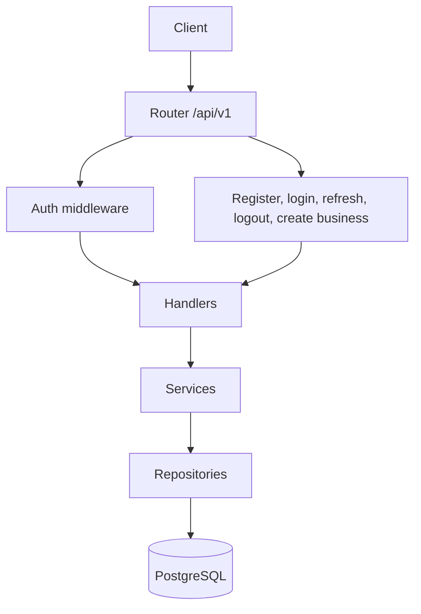
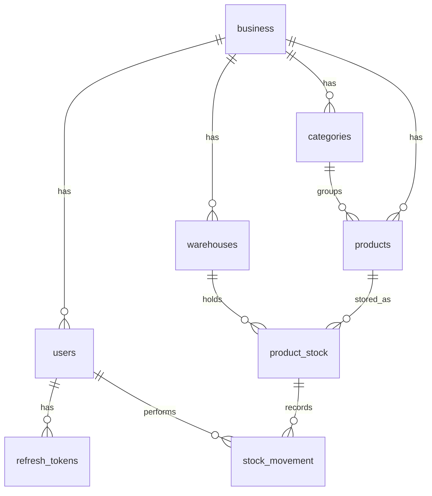

# Inventory Management Backend

Go API for Invento. It stores businesses, users, catalogs, warehouse stock, and stock movements in PostgreSQL, and issues short-lived JWTs for the mobile app.

## Project Overview

`inventory-mgmt-backend` is the HTTP API behind Invento Pro. An owner registers, creates a business, and then manages categories, products, warehouses, and employees. Stock is tracked per product and warehouse. Movements record sales, receipts, returns, and damage.

The server is a single Go process. `cmd/app.go` opens PostgreSQL, wires repositories, services, and handlers, and listens on `PORT` (default `8080`). Routes live in `src/router/router.go` under `/api/v1`.

## Features

- Owner registration and login, with employee accounts created by an authenticated user
- Access tokens (15 minutes) and rotating refresh tokens (30 days)
- Business, category, product, and warehouse records scoped by `business_id`
- Inventory totals per product and warehouse
- Stock movements of type `SALE`, `RETURN`, `DAMAGE`, and `RECEIVE`
- Dashboard and inventory stats endpoints
- Request validation through `go-playground/validator`

## Tech Stack

- Go 1.25 (`module inventory-backend`)
- `net/http` with Go 1.22+ method-and-path patterns
- PostgreSQL via `database/sql` and `github.com/lib/pq`
- JWT (`github.com/golang-jwt/jwt/v5`), HS256
- Password hashing with `bcrypt` (`golang.org/x/crypto/bcrypt`)
- UUIDs (`github.com/google/uuid`)

## Architecture

Each feature is split into handler, service, and repository. Handlers decode HTTP. Services apply rules. Repositories run SQL. The auth middleware reads the bearer token and stores the user id, business id, and role on the request context.



### Sign-in and refresh

1. `POST /api/v1/auth/register` creates an owner. The password is stored as a bcrypt hash. Login is rejected until that user has a business id.
2. `POST /api/v1/business` creates the business. This route does not use the auth middleware.
3. `POST /api/v1/auth/login` checks the password, then returns an access token and a refresh token. The refresh token is SHA-256 hashed before it is inserted into `refresh_tokens`, with `expires_at` 30 days out.
4. `POST /api/v1/auth/refresh` revokes the presented refresh token and issues a new pair.
5. `POST /api/v1/auth/logout` revokes the refresh token.

Protected routes expect `Authorization: Bearer <access token>`.

### Stock movement

`PATCH /api/v1/stock-movement` is authenticated. Movement types accepted by the schema are `SALE`, `RETURN`, `DAMAGE`, and `RECEIVE`. History is `GET /api/v1/stock-movement`. Current stock is `GET /api/v1/inventory`.

## Local Setup

The process reads the environment directly. It does not load a `.env` file. Copy `.env.example` and export the variables in the shell before starting the server.

```bash
go mod download
createdb inventory
# apply the SQL files in src/db/db_queries (see Database Design)
export DB_MODE=dev
export DB_DEV='host=localhost port=5432 user=postgres password=postgres dbname=inventory sslmode=disable'
export JWT_SECRET_KEY='replace-with-a-long-random-string'
export PORT=8080
go run ./cmd/app.go
```

`DB_MODE=local` builds the connection string from separate variables instead of `DB_DEV` / `DB_PROD`:

```bash
export DB_MODE=local
export DB_HOST=localhost
export DB_PORT=5432
export DB_USER=postgres
export DB_PASSWORD=postgres
export DB_NAME=inventory
export DB_SSLMODE=disable
```

### Environment variables

| Variable | Used by | Purpose |
| --- | --- | --- |
| `PORT` | `cmd/app.go` | Listen port. Defaults to `8080` when unset. |
| `DB_MODE` | `src/db/conn.go` | `dev`, `prod`, or `local`. Any other value fails startup. |
| `DB_DEV` | `DB_MODE=dev` | Postgres connection string. |
| `DB_PROD` | `DB_MODE=prod` | Postgres connection string. |
| `DB_HOST`, `DB_PORT`, `DB_USER`, `DB_PASSWORD`, `DB_NAME`, `DB_SSLMODE` | `DB_MODE=local` | Pieces of the local connection string. |
| `JWT_SECRET_KEY` | `src/auth/token.go` | HS256 signing key for access tokens. |

`.env.example` lists `JWT_SECRET`. The server reads `JWT_SECRET_KEY`. Set `JWT_SECRET_KEY` or tokens will not verify.

List defaults used when query parameters are omitted (`src/constants/constants.go`): page `1`, limit `10`, sort `created_at` descending, date window `2026-01-01` through `2026-12-31`, movement type `SALE`.

## Database Design

PostgreSQL. Primary keys are UUIDs (`gen_random_uuid()`). The server does not run migrations on startup. Apply the scripts in `src/db/db_queries` yourself. Create tables before the tables that reference them:

1. `create/create_business_table.SQL`
2. `create/create_users_table.SQL`
3. `create/create_refresh_token.SQL`
4. `create/create_category_table.SQL`
5. `create/create_warehouse_table.SQL`
6. `create/create_product_table.SQL`
7. `create/create_product_stock_table.SQL`
8. `create/create_stock_movement_table.SQL`
9. The scripts under `db_queries/update/` (column adds, uniqueness, and indexes)

| Table | Role |
| --- | --- |
| `business` | Organization. `name` is unique. |
| `users` | `owner` or `employee`. Unique email. `password_hash`. Optional `business_id`. `is_active`. |
| `refresh_tokens` | SHA-256 `token_hash` (unique), `expires_at`, `revoked_at`. |
| `categories` | Unique `(business_id, name)`. |
| `warehouses` | Unique `(business_id, name)`. |
| `products` | Name, SKU, `selling_price`, `cost_price` (both `>= 0`), `image_url`, category, business. |
| `product_stock` | `current_stock >= 0`. Unique `(warehouse_id, product_id)`. |
| `stock_movement` | Type in `SALE`, `RETURN`, `DAMAGE`, `RECEIVE`. `movement_quantity > 0`. `reason` required. |

Deleting a business cascades to users, categories, warehouses, products, product stock, and movements that reference it.



## API Overview

Base path `/api/v1`. JSON in and out. Protected routes need `Authorization: Bearer <access token>`.

| Method | Path | Auth | Purpose |
| --- | --- | --- | --- |
| POST | `/auth/register` | No | Register an owner |
| POST | `/auth/login` | No | Access token and refresh token |
| POST | `/auth/refresh` | No | Rotate refresh token |
| POST | `/auth/logout` | No | Revoke refresh token |
| POST | `/auth/employee` | Yes | Create an employee |
| GET | `/auth/employee` | Yes | List employees |
| DELETE | `/auth/employee/{id}` | Yes | Delete an employee |
| POST | `/business` | No | Create a business |
| POST, GET | `/category` | Yes | Create or list categories |
| PATCH, DELETE | `/category/{id}` | Yes | Edit or delete a category |
| POST, GET | `/warehouse` | Yes | Create or list warehouses |
| PATCH, DELETE | `/warehouse/{id}` | Yes | Edit or delete a warehouse |
| POST, GET | `/product` | Yes | Create or list products |
| PATCH, DELETE | `/product/{id}` | Yes | Edit or delete a product |
| GET | `/product/stock/list` | Yes | Products with stock |
| PATCH, GET | `/stock-movement` | Yes | Record a movement, or list history |
| GET | `/inventory` | Yes | Inventory list |
| GET | `/dashboard` | Yes | Dashboard payload |
| GET | `/inventory/stats` | Yes | Inventory stats |

`POST /api/v1/auth/forgot-password` is present in the router only as a comment.

## Security

- Passwords are bcrypt hashes. The API does not return the hash.
- Access tokens last 15 minutes and carry the user id (`sub`), business id, and role.
- Refresh tokens are stored only as SHA-256 hashes. Refresh rotates the token: the presented hash is revoked, then a new one is saved.
- Protected handlers go through `src/auth/middleware.go`, which requires a `Bearer` token.
- Roles stored on users are `owner` and `employee`.
- Keep `JWT_SECRET_KEY` and database URLs out of git. `.gitignore` should be checked before committing env files.
- Debug logs in the token repository include the refresh-token hash argument. Leave debug logging off on shared hosts.

`POST /api/v1/business` is not behind the middleware. Registration can succeed before a business exists, which is why login requires a business id.

## Design Decisions

- Hand-written SQL in `src/db/db_queries`, called from repositories, instead of an ORM. Schema changes are SQL files you apply yourself.
- One database connection for dev, prod, or a local host, selected by `DB_MODE`.
- Stateless access tokens plus a server-side refresh-token table, so logout and refresh can revoke a session.
- Stock quantity lives on `product_stock` (product × warehouse). Movements are a separate history table.
- Business scoping is on the token (`business_id` claim) and on the foreign keys.

## Optimizations

- `product_stock` has a uniqueness constraint on `(warehouse_id, product_id)`, so a product has one stock row per warehouse.
- `db_queries/update/create_index_on_product_stock.SQL` is an extra index script. Apply it with the other update scripts.
- List endpoints default to 10 rows per page.
- The HTTP server is the standard library. There is no connection pool tuning beyond `database/sql` defaults.

## Deployment

There is no Dockerfile in this repo. Run the binary with `DB_MODE=prod`, `DB_PROD` set to the production Postgres URL, and `JWT_SECRET_KEY` set in the host environment.

The Invento Pro app's EAS profiles call this API on Render (`inventory-mgmt-backend-09g6.onrender.com` for development and preview, `inventory-mgmt-backend-prod.onrender.com` for production). Those hosts are configured in the frontend repo, not here.

```bash
go build -o inventory-backend ./cmd/app.go
DB_MODE=prod DB_PROD="$DATABASE_URL" JWT_SECRET_KEY="$JWT_SECRET_KEY" PORT=8080 ./inventory-backend
```

Apply the SQL scripts to the production database before the first boot. The process only pings Postgres; it will not create tables.

## Lessons Learned

- Registration and business setup are separate calls. Login fails with `business id is required` until the business row exists.
- The env example and the code disagree on the JWT variable name. The code wins: `JWT_SECRET_KEY`.
- Refresh is one-time. `MarkTokenExpired` sets `revoked_at` before a new token is stored, so a reused refresh token will not match `revoked_at IS NULL`.
- Schema SQL is source-controlled but not executed by the app. A new environment needs those files applied in foreign-key order.

## License

MIT. Copyright (c) 2026 Rishabh Sharma. See [LICENSE](LICENSE).
